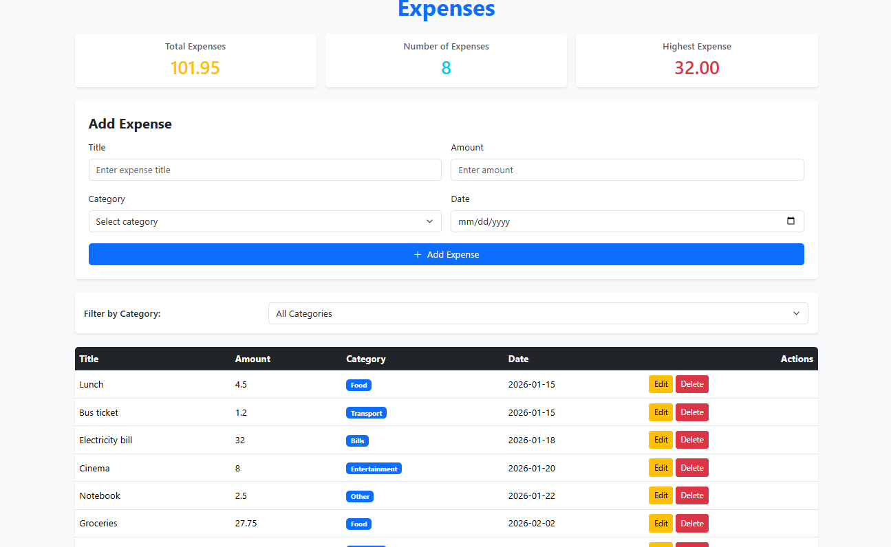
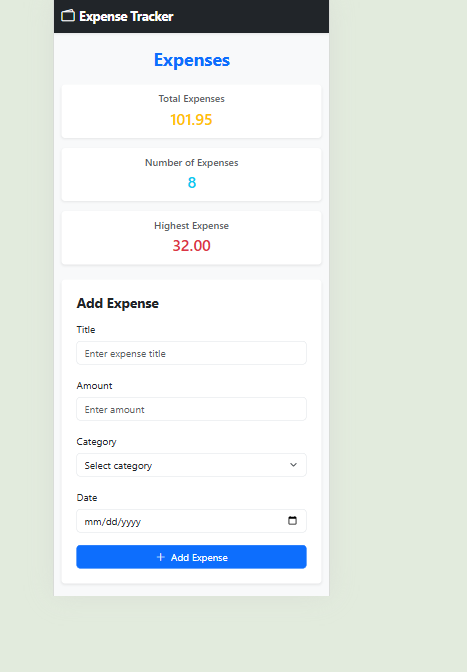
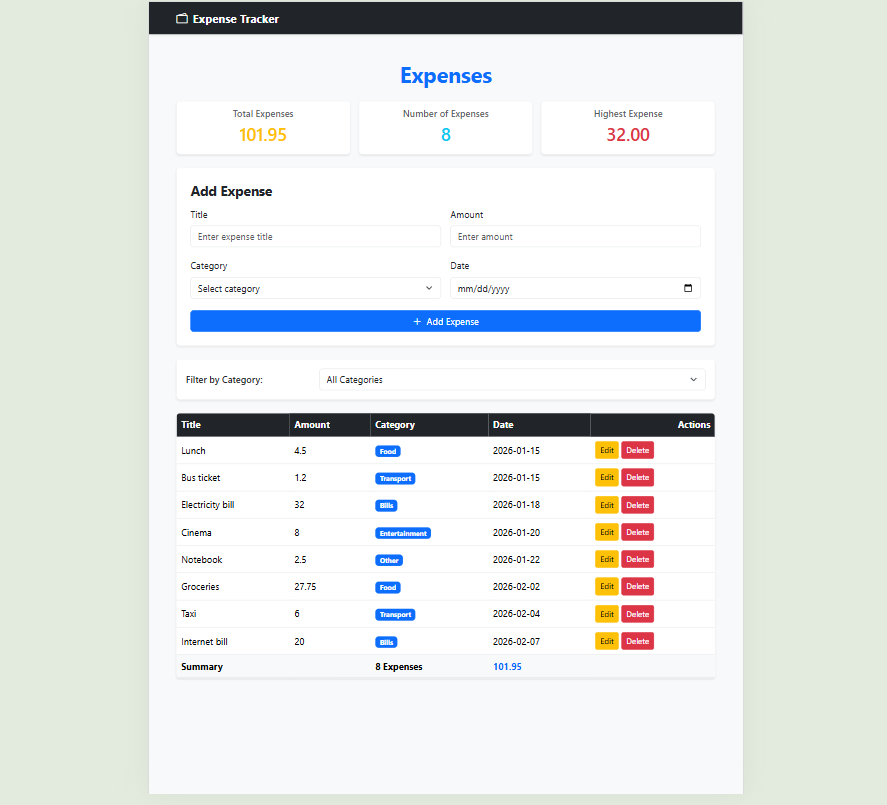

# Expense Tracker

A simple Expense Tracker application that allows users to manage their expenses and store the data in a PostgreSQL database.

## How to Run

### Backend

1. Make sure you have **Node.js**, **PostgreSQL**, and **VS Code** installed.

2. Open the project folder in VS Code.

3. Open the terminal and install the required dependencies:

```bash
npm install
```

4. Create a PostgreSQL database named:

```text
practice_tracker_expense
```

5. Run the `schema.sql` file to create the required database tables.

6. Create a new file named `.env` in the project root.

7. Add your PostgreSQL connection information to the `.env` file:

```env
DB_HOST=localhost
DB_PORT=5432
DB_NAME=practice_tracker_expense
DB_USER=postgres
DB_PASSWORD=1234
```

8. Start the backend server:

```bash
node server.js
```

9. The backend will run on:

```text
http://localhost:3000
```

### Frontend

1. Open the frontend folder in VS Code.

2. Open the main HTML file using **Live Server**.

3. The application will open in your browser.

4. Make sure the backend server is running before using the application.

## Features

* [ ] Add an expense (with validation)
* [ ] Delete an expense
* [ ] Edit an expense
* [ ] Filter by category
* [ ] Summary cards (total, count, highest)
* [ ] Data is saved in a PostgreSQL database

## Screenshots

### Desktop

### iPhone 16 Pro Max

### iPad 13 Pro


## What was the hardest part?

The hardest part was connecting the frontend with the backend and making sure that data was sent and received correctly through the API. It required careful testing of requests, responses, validation, and database operations.

Another challenge was the self-learning parts of the project. More time could have been given to researching and practicing these topics, especially API integration,  and responsive design, to make the implementation more complete and polished.


## link demo video
https://drive.google.com/file/d/1h8sKARVIIYe5OeUAbuRtCJOlwtHZN9Ip/view?usp=sharing